# Link Shortener for the Call Center

1. [Problem](#1-problem)
2. [MVP solution](#2-mvp-solution)
3. [Problems on the way up](#3-problems-on-the-way-up)
   1. [Redirect traffic and hot shared links](#31-redirect-traffic-and-hot-shared-links)
   2. [Mass sends of personal links](#32-mass-sends-of-personal-links)
   3. [Click recording load](#33-click-recording-load)
   4. [Data growth](#34-data-growth)
   5. [Wrong click numbers](#35-wrong-click-numbers)
   6. [Abuse and code guessing](#36-abuse-and-code-guessing)
   7. [Not needed until a much larger scale](#37-not-needed-until-a-much-larger-scale)
4. [Final system](#4-final-system)
5. [Rollout plan](#5-rollout-plan)
6. [Cost](#6-cost)
7. [Risks](#7-risks)

---

## 1. Problem

### 1.1 What the Call Center needs

The Call Center sends customers long links in SMS and messengers, and sometimes reads them over the phone. Typical
links:

- **Personal link** — a payment page for one order; the URL contains a customer token.
- **One-time link** — a survey that the customer can open only once.
- **Shared link** — a promo or discount page for many customers.
- **Permanent link** — a QR code printed on a receipt or a parcel; it cannot be changed after printing.

Long links:

- take a large part of an SMS and can split it into two paid messages;
- are impossible to dictate;
- look suspicious (long query strings, tracking parameters);
- give no feedback: the Call Center does not know if the customer opened the link and how many times.

The Call Center wants short links on a branded domain that are easy to read aloud, count how many times the customer
opened them, and stop working when their purpose ends.

The Call Center requests a short link in the back office and sends it to the customer. The **Link Shortener**
redirects the customer to the destination page and updates the statistics. How it stays fast and reliable under load
is described in [section 3](#3-problems-on-the-way-up).

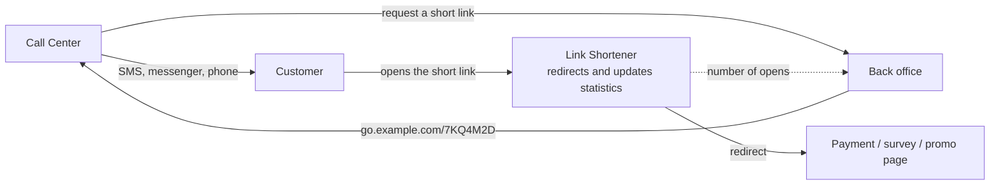

### 1.2 Spec

**Users and use cases**

| User | Use case |
|---|---|
| Call Center | Creates a short link of the needed kind for an allowed page, copies it into an SMS or a chat, reads it over the phone. Sees if and how many times the customer opened the link. |
| Customer | Opens the short link and gets to the page. Sees a clear page if the link is expired, disabled or already used. |
| Admin | Sees the statistics, finds and disables a link, manages the destination domains (active or blocked). |

**Functional requirements**

| # | Requirement | MVP |
|---|---|---|
| F1 | Create a short link of a kind — personal, one-time, shared or permanent (see [link kinds](#13-assumptions)) — for a destination on an allowed domain, with an expiry by kind. | yes |
| F2 | Create links in bulk mode: a list of destinations for a mass send; the links are marked as bulk. | later |
| F3 | Redirect the short link to its destination. | yes |
| F4 | A one-time link works only once; the next opens show "this link was already used". | yes |
| F5 | Show a "link is not valid" page for an expired, disabled, used or unknown link. | yes |
| F6 | Count the opens of each link; show the number of opens and the first open. | yes |
| F7 | List, search and update links in the back office: disable or enable a link, change its expiry. | yes |
| F8 | Statistics dashboard by period and by link kind. | later |
| F9 | QR codes for shared and permanent links. | later |
| F10 | Custom aliases (`go.example.com/sale`) for shared and permanent links. | later |

**Non-functional requirements**

| Area | Requirement |
|---|---|
| Latency | Redirect p95 < 50 ms inside the service. |
| Availability | 99.9% for redirects: links already sent in SMS must keep working. |
| Security | Codes are hard to guess; only allowed destination domains; only authenticated users create links. |
| Destination URL | Up to 2,048 characters, validated on creation. |
| Audit | Who created and who disabled each link. |

**Out of scope:** editing the destination after the link was sent, A/B tests, marketing analytics.

### 1.3 Assumptions

The numbers below drive the design and the cost. They must be confirmed in discovery (see [1.4](#14-questions-for-the-call-center-team)).

The MVP is built for the Call Center volume below. Higher load — mass sends, popular shared links — is not planned now,
but the architecture must allow it: [section 3](#3-problems-on-the-way-up) describes each high-load problem and its
solution, and [section 4](#4-final-system) shows the final design.

| | MVP |
|---|---|
| Who creates links | Call Center (100–200 people) in the back office |
| New links | ~10k per day, ~3.6M per year |
| Destination URL | up to 2,048 characters; ~200–500 characters with tokens and tracking parameters |
| Redirect load | depends on the link kind (see below); a few requests per second for the Call Center volume |

**Link kinds**

| | Personal link | One-time link | Shared link | Permanent link |
|---|---|---|---|---|
| Example | payment page of one order | survey | promo or discount page | QR code printed on a receipt or a parcel |
| Opens | one customer, a few times | one customer, once | many customers | many customers, for months |
| Personal data in the URL | yes (tokens) | yes (customer id) | no | no |
| Expiry | short (30 days by default) | 30 days by default, and after the first open | until the end of the promo (`expires_at` is required) | none: it cannot be changed after printing |
| Code | random only | random only | random or custom alias | random or custom alias |
| Cache | only in bulk mode (see [3.2](#32-mass-sends-of-personal-links)) | never: every open must be checked | on the first open (see [3.1](#31-redirect-traffic-and-hot-shared-links)) | on the first open |

**Bulk mode** is a flag, not a kind: personal or one-time links created at once for a mass send. It tells the system
to warm the cache when the links are created ([4.1](#41-where-when-and-why-we-cache)).

**Data growth at the MVP volume**

| Table | Rows | Size per row with indexes | Per year | With 90-day retention ([3.4](#34-data-growth)) |
|---|---|---|---|---|
| `short_links` | ~10k per day | ~0.6–0.8 KB (URL ~300–500 B + other columns + indexes) | ~3.6M rows, ~2–3 GB | ~0.9M rows, ~0.5–0.7 GB |
| `domains` | tens of rows | — | negligible | — |

Formula: `rows × (row size + index size)`. Opens only update the counter on the link, so they do not add rows.

The core of the service is one table with a unique index on the code. The real difficulty is in the requirements,
abuse prevention, reliability of links already sent, correct click counts and cost. This document starts with the
simple solution and adds complexity only when a named trigger happens.

### 1.4 Questions for the Call Center team

1. Why do you need short links: SMS length, dictation over the phone, tracking, trust?
2. Which channels: SMS, messengers, email, phone?
3. Who creates links?
4. How many links per day? Will mass sends (tens of thousands of links at once) go through this service?
5. How long must a link work? Which links must be one-time?
6. Which analytics: "opened / not opened", or dashboards by team and period?
7. Do you need custom aliases (`go.example.com/sale`) or QR codes?
8. Which destination domains must be allowed?
9. How long can we keep links and their statistics (personal data rules)?

---

## 2. MVP solution

### 2.1 Overview

How the MVP works:

- **Link creation.** The Call Center creates a link in the back office. The back office checks the destination,
  generates a random 7-character code and saves the link with its kind and expiry. The short link is ready to copy or
  to read aloud at once. The code uses Crockford Base32 (no I, L, O, U; case does not matter), so it is easy to
  dictate. There are ~34 billion possible codes, so they are hard to guess: with ~1M active links one random code
  hits a link about once in 35,000 tries; such a search shows up in the 404 rate alert, and rate limits
  ([3.6](#36-abuse-and-code-guessing)) stop it.
- **Redirect.** The customer opens `go.example.com/<code>`. The redirect endpoint finds the link by its code — a
  lookup by a unique index is very fast — checks that the link is active and answers with a `302` to the destination.
- **`302`, not `301`.** Browsers do not cache a `302`, so every open reaches the service and a disabled link stops
  working at once.
- **Every open schedules a `LinkProcessor` background job** (Sidekiq). The job increments the counter, sets the first
  open time, marks a one-time link as used and deletes its cache key when a cache exists. These are writes, so they do
  not run inside the `GET` request, and the redirect does not wait for them. The job is small and fast. The jobs run in
  a separate queue with a **limited concurrency** (for example 5 threads): if all Sidekiq threads (for example 60) ran
  these jobs at the same time during a peak, they could overload the database. During a peak the jobs wait in the
  queue, and the statistics are updated a little later.
- **A one-time link can open twice in a rare case**: two opens at almost the same time, or a second open while the
  job still waits in the queue. This edge case is acceptable: the form or the payment on the destination page checks
  itself whether it was already used.
- **No cache in the MVP.** At the Call Center volume the lookup by code is enough. The cache is added when one of the
  triggers in [section 3](#3-problems-on-the-way-up) happens.

**Conditions on link creation**

| Condition | Result |
|---|---|
| The destination domain is not in `domains`, or its status is `blocked` | `422`: the domain is not allowed |
| The destination is not a valid `https` URL, or it is longer than 2,048 characters | `422`: invalid destination |
| `expires_at` is in the past, or it is set for a permanent link | `422`: invalid expiry; without `expires_at` the default of the kind is used |
| A shared link without `expires_at` | `422`: the end of the promo is required |
| The generated code already exists (the insert fails on the unique index) | Only then generate a new code and insert again, at most 5 attempts in total; after 5 failures return `500` and send an alert — at our volume this means the code space is too full and the codes must be longer |

**Conditions on redirect**

| Condition | Result |
|---|---|
| The code is typed or dictated with lowercase letters, `O` instead of `0`, `I` / `L` instead of `1` | The code is normalized (Crockford Base32) before the lookup, so it still works |
| No link with this code | `404` page: this link does not exist |
| The link is expired, disabled, or a used one-time link | `410` page: this link is not valid any more |
| The link is active | `302` to the destination, `LinkProcessor` is scheduled |

### 2.2 Architecture

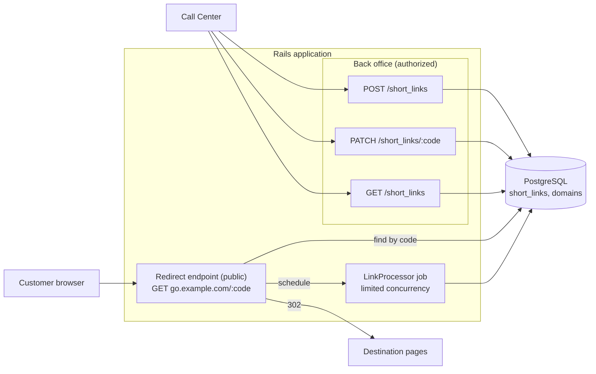

**Endpoints**

| Endpoint | Called by | Request | Response |
|---|---|---|---|
| `POST /short_links` | back office | `destination_url`, `kind` (`personal`, `one_time`, `shared`, `permanent`), `expires_at` (optional, default by kind) | `201` `{ code, short_url, kind, expires_at }`; `422` with the reason (see the conditions above) |
| `GET /short_links` | back office | filters: `code`, `kind`, `status` (`active`, `expired`, `used`, `disabled`), `created_by`, page | `200` list of links with `clicks_count`, `first_clicked_at`, status |
| `PATCH /short_links/:code` | back office | `disabled` (`true` to disable, `false` to enable), `expires_at`; the destination cannot be changed | `200` the updated link; `422` with the reason; the cache key is deleted when a cache exists |
| `GET go.example.com/:code` | customer | the code in the path; user agent from the headers | `302` with `Location: <destination>`; `404` unknown code; `410` expired, disabled or used link |

The back office endpoints require authorization. The redirect endpoint is public.

### 2.3 Data model

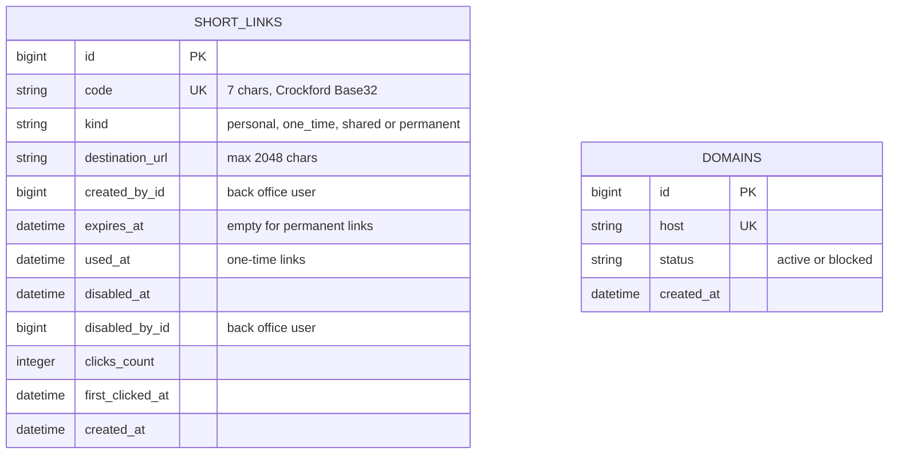

Only the number of opens and the first open are stored. There is no table of single clicks: no requirement needs
them, and they would only add personal data (user agents, IP addresses) and storage.

### 2.4 Flows

**Create a link**

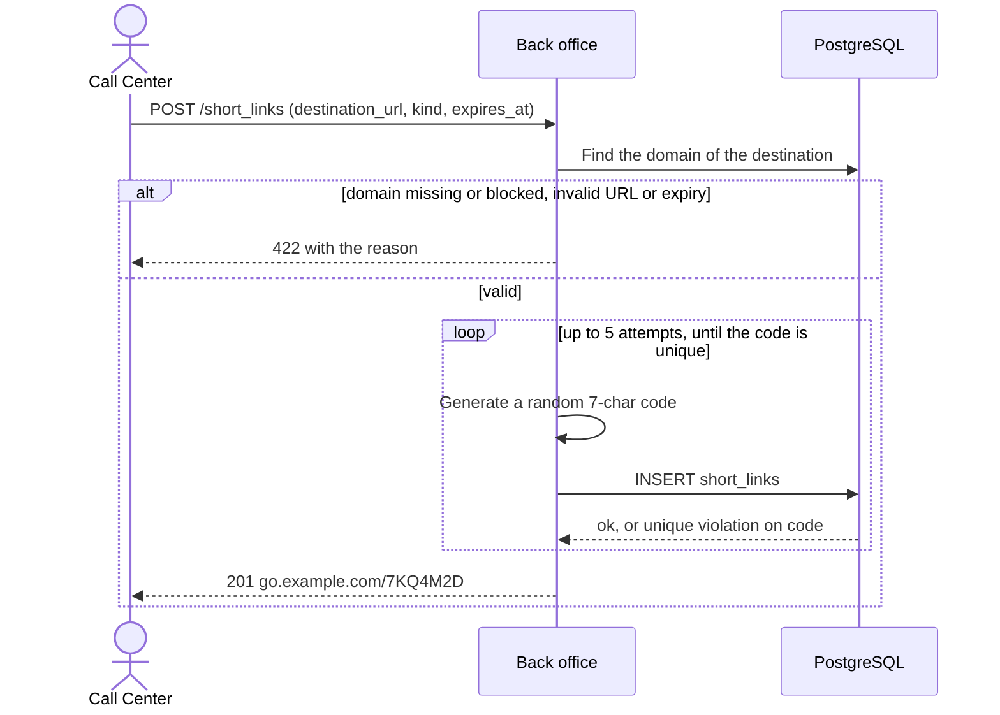

The code is generated once. A new code is generated only when the insert fails because the code already exists;
after 5 attempts in total the request fails with `500` and an alert.

**Redirect**

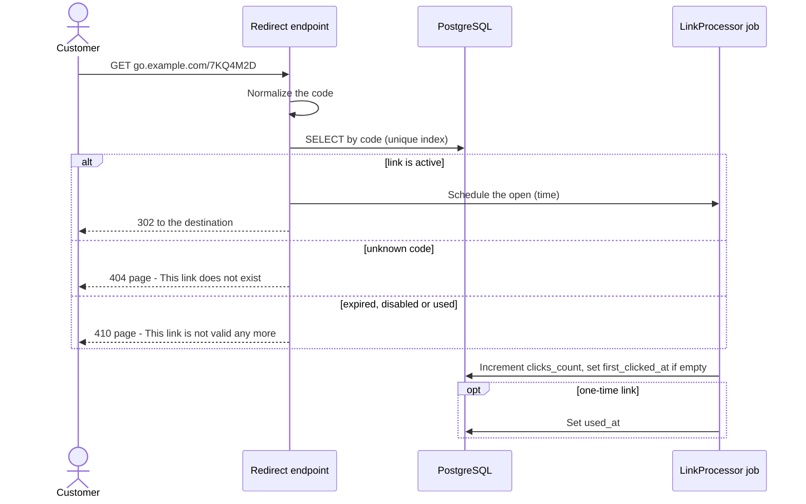

### 2.5 Security baseline

- **Destination domains.** A link can point only to a domain with the status `active` in `domains`. This is the most
  important rule: without it the service becomes a phishing tool under our brand. A blocked domain cannot be used for
  new links.
- **Only authenticated Call Center users create and update links**; the redirect endpoint is public.
- **Unguessable codes**; a 404 rate alert shows attempts to guess codes.
- **Expiry is checked on every redirect**: an expired, disabled or used link returns `410`.
- **Audit:** who created and who disabled each link.

---

## 3. Problems on the way up

The MVP covers the Call Center volume. Mass sends and popular shared or permanent links are not planned now, but the
design must allow them. Each section below describes one high-load problem: the trigger, why the simple solution
breaks, the options, the choice and its cost. We add a solution only when its trigger happens; all of them together
make the [final system](#4-final-system).

### 3.1 Redirect traffic and hot shared links

- **Trigger:** redirect p95 > 50 ms, more than ~100 redirects per second, or shared / permanent links opened by many
  customers.
- **Why the MVP breaks:** every redirect is a query to the same PostgreSQL that serves the rest of the application.
  A shared link sent to 100k customers sends the same query thousands of times.
- **Options:**
  1. Redis as a shared cache — one copy for all application servers, a key can be deleted at once when a link
     changes; one more service to run.
  2. A read replica of PostgreSQL — no cache invalidation, but every redirect still goes to a database.
- **Choice:** Redis cache-aside for shared and permanent links. They are the same for everybody, so the first open
  reads the link from PostgreSQL and puts it into Redis; every next open is served from Redis. The cached entry keeps
  the destination, `expires_at` and the status, so the redirect checks them exactly as in the MVP. When a link is
  updated or disabled, its key is deleted.

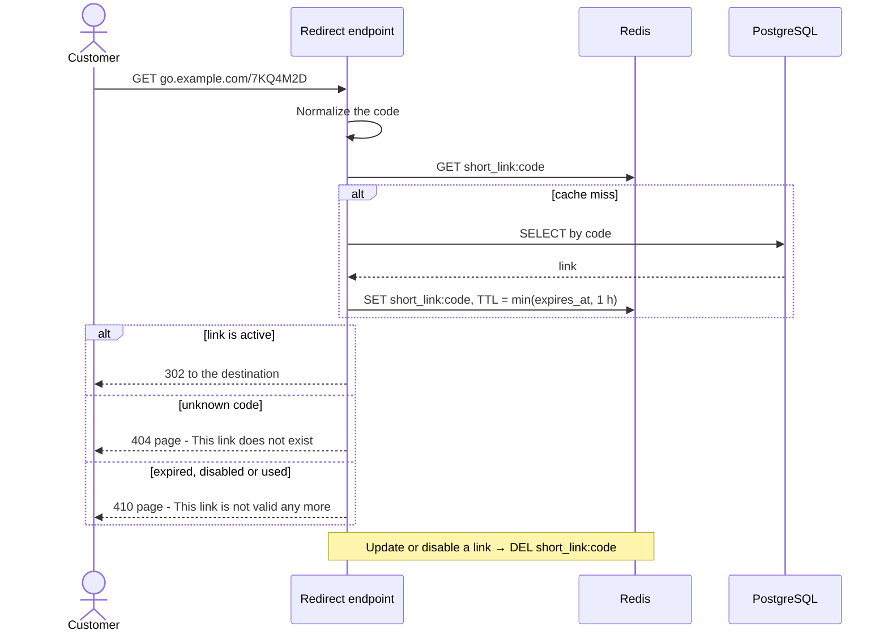

- **Memory:** the worst case for one cached link, with a destination URL of the maximum length:

  | Part | Bytes |
  |---|---|
  | Key `short_link:7KQ4M2D` | ~18 |
  | Destination URL (maximum) | 2,048 |
  | `expires_at` and status | ~20 |
  | Redis overhead per key with a TTL | ~80 |
  | **Total** | **~2.2 KB** |

  | Cached links | Memory |
  |---|---|
  | 1,000 | ~2.2 MB |
  | 10,000 | ~22 MB |
  | 100,000 | ~220 MB |

  Only shared and permanent links are cached here, so there are hundreds or thousands of keys: a few megabytes. Real
  URLs are usually 200–500 characters, so the real memory is several times smaller.
- **Cost:** 1–2 days. Redis runs as a small managed instance with 1–2 GB of memory, which costs about $25 per month.

### 3.2 Mass sends of personal links

- **Trigger:** personal or one-time links are created in bulk mode for a mass send — tens of thousands at once
  ([F2](#12-spec)).
- **Why the MVP breaks:** 100k links cannot be created one by one; and a cache-aside cache does not help personal
  links: each link is opened by one customer, so the first open always goes to the database, exactly at the moment
  when thousands of customers open their SMS.
- **Choice:**
  - **Bulk creation:** the Call Center uploads a list in the back office; a background job creates the links in
    batches (one `INSERT` per batch of 1,000) and marks them with a new `bulk` column.
  - **Write-through cache (warm cache):** the same job writes every new personal link to Redis (pipeline) with
    TTL = min(expires_at, 48 h). Most SMS are opened in the first 24–48 hours; after the TTL a link still works from
    PostgreSQL, which stays the source of truth.
  - One-time links are not cached even in bulk mode ([4.1](#41-where-when-and-why-we-cache)).

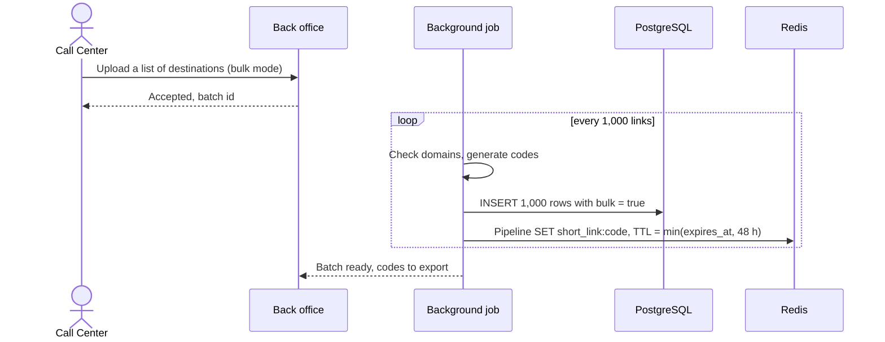

- **Memory:** `links in the TTL window × size of one cached link`, with the same size as in
  [3.1](#31-redirect-traffic-and-hot-shared-links): ~2.2 KB in the worst case, ~0.5 KB for a usual URL of 200–500
  characters.

  | 600k links in 48 hours | Memory | Redis instance |
  |---|---|---|
  | Usual URLs (~0.5 KB) | ~300 MB | the same small instance as in 3.1 (1–2 GB), about $25 per month |
  | Worst case (~2.2 KB) | ~1.3 GB | the next size (~3 GB), about $50 per month — Redis needs free memory above the data |

- **Cost:** ~3 days; the Redis instance from the table above.

### 3.3 Click recording load

- **Trigger:** the `LinkProcessor` queue delay stays high for a long time (for example more than 15 minutes) even with
  the limited concurrency — the statistics in the back office are too old.
- **Why the MVP breaks:** the job itself is fast, but every open is one job and one `UPDATE` of the counter. A shared
  link opened thousands of times updates the same row thousands of times (a hot row), and the limited concurrency
  makes the queue long.
- **Choice:** the redirect increments the counter in Redis at once (`INCR clicks:code`), saves the time of the first
  open (`SET first:code <time> NX`) and does not schedule a job. A scheduled job **every 15 minutes** syncs Redis with
  PostgreSQL: one `UPDATE` per link with the sum of its opens, and `first_clicked_at` if it is empty.
  The statistics in the back office are up to 15 minutes old. One-time links still schedule `LinkProcessor`, because
  they must be marked as used.

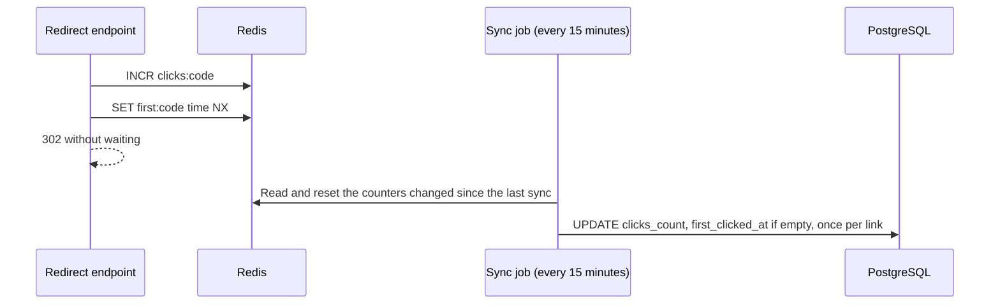

- **Cost:** ~1 day. Risk: if Redis loses data, the opens since the last sync (up to 15 minutes) are not
  counted — acceptable for statistics. Redis persistence (AOF) reduces the risk.

### 3.4 Data growth

- **Trigger:** high load, for example mass sends of up to ~300k links per day — ~110M link rows per year.
- **Why the MVP breaks:** the table and its indexes grow without limit; personal data is kept longer than needed.
- **Choice:**
  - **Retention:** a daily job deletes expired and used links older than 90 days (in batches). With 90 days the links
    table stays at ~27M rows in this example. Permanent links are not deleted while they are active.
  - **Monthly partitions** of `short_links` if row-by-row deletion becomes too slow: delete a whole month by dropping
    a partition. The partition key is a `partition_month` column: the month of creation, and a fixed far-future month
    for permanent links, so they stay in their own partition and are never dropped. PostgreSQL requires the partition
    key in every unique index, so the unique index is `(code, partition_month)`. New links always go to the partition
    of the current month, where this index stops duplicates; a code from an older month is found by a `SELECT` by code
    before the insert.
  - Storage formula: `rows × (row size + index size)`; ~0.6–0.8 KB per link row with indexes (as in
    [1.3](#13-assumptions)): ~110M rows per year take ~66–88 GB without retention, ~27M rows with 90 days take
    ~16–22 GB.
- **Cost:** 1–2 days of development.

### 3.5 Wrong click numbers

- **Trigger:** links are sent in messengers; the "opened" status shows opens that customers did not do.
- **Why the MVP breaks:** messengers and email clients open a link to build a preview; security scanners open it too.
  These requests look like a customer click.
- **Choice:** do not count requests from known preview bots (checked by the user agent in the redirect request);
  count repeated opens from the same IP within 10 seconds once (a Redis key with a hash of the IP and a 10-second
  TTL; nothing is stored in the database).
- **Cost:** 1–2 days.

### 3.6 Abuse and code guessing

- **Trigger:** spikes of 404 responses (somebody tries codes), or a large number of links created by one user.
- **Choice:** rate limits on redirects per IP and on creation per user, with counters in a shared store
  (Redis, or Solid Cache without Redis); an alert on the 404 rate.
- **Cost:** 1–2 days.

### 3.7 Not needed until a much larger scale

| Solution | Trigger |
|---|---|
| Pre-generated code pool (key generation service) | Code collisions or code generation become a bottleneck — not before billions of codes. |
| Sharding of `short_links` | One PostgreSQL primary cannot hold the data even with retention. |
| Redirect servers in several regions | Customers in other countries or continents wait too long for the redirect from one data center; a copy of the redirect in a region closer to them would answer faster. |

---

## 4. Final system

All solutions from section 3 together, with all high-load triggers active.

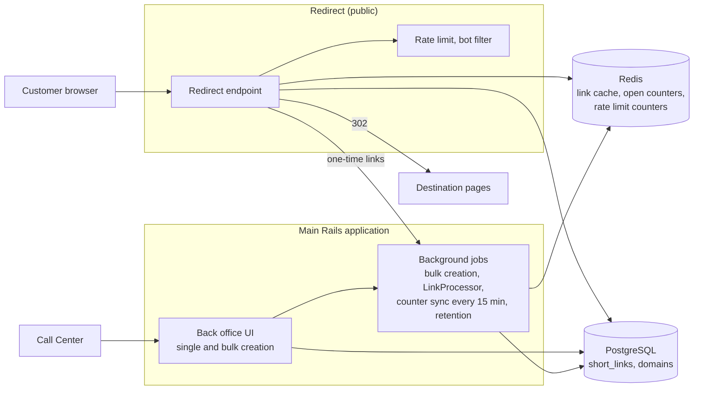

The redirect endpoint lives in the main Rails application; it is drawn as a separate block only to show the public part.

### 4.1 Where, when and why we cache

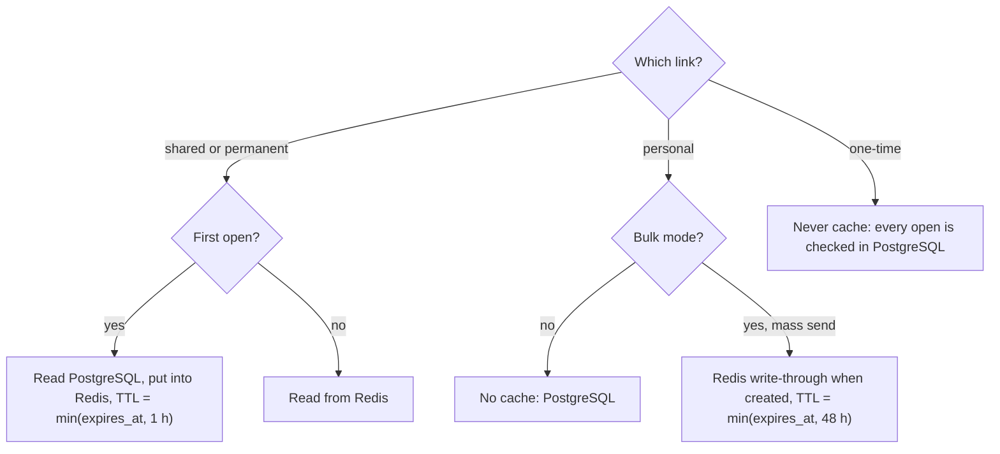

The link kind and the bulk flag decide the cache:

- **Shared and permanent links** are the same for everybody, so the first open puts them into the cache
  (cache-aside), and every next open is served from it.
- **Personal links in bulk mode** are opened by one customer each, mostly in the first hours after the SMS, so
  cache-aside never hits; the cache is warmed when the links
  are created (write-through), right before customers open their SMS.
- **Personal links created one by one** go to PostgreSQL: a few opens per second need no cache.
- **One-time links** are never cached: `LinkProcessor` must mark them as used, and a cached copy would let the next
  open through.

| Rule | Reason |
|---|---|
| PostgreSQL is always the source of truth; Redis only caches. | Losing the cache must never break a link. |
| One-time links are never cached. | The first open must mark the link as used before the next open. |
| Every TTL is ≤ `expires_at`. | An expired link must not work from the cache. |
| Disabling a link deletes its cache key. | The link stops at once, not after the TTL. |
| Redis is private, with TLS; TTLs are short. | Personal tokens are stored in the cache for a limited time. |

### 4.2 Redirect in the final system

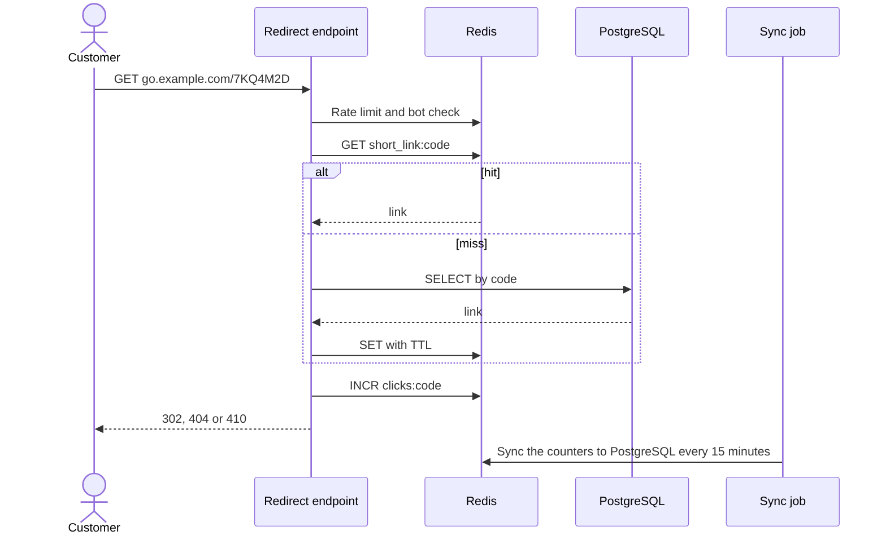

---

## 5. Rollout plan

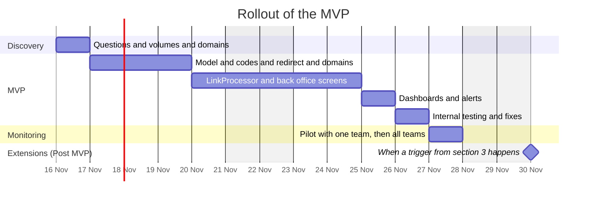

| Phase | Entry | What happens | Exit |
|---|---|---|---|
| 0. Discovery | Questions in [1.4](#14-questions-for-the-call-center-team) | Confirm volumes, link kinds, domains, retention; measure real URLs. | MVP scope confirmed. |
| 1. MVP | Scope confirmed | Build [section 2](#2-mvp-solution); internal testing on the short domain. | All checks pass; dashboards and alerts work. |
| 2. Monitoring | MVP ready | One Call Center team (~10%) starts using short links in SMS; when the metrics are fine, all teams join the same day; SMS templates use short links. We watch the [metrics below](#5-rollout-plan). | Service targets hold; adoption target reached. |
| 3. Extensions (Post MVP) | A trigger from [section 3](#3-problems-on-the-way-up) happens | Add the solution of that problem. | The trigger metric is back to normal. |

**Metrics we watch in the Monitoring phase.** The targets marked "agree" are set with the Call Center in discovery.

Does the Call Center use short links, and do they help?

| Metric | How we count it | Target |
|---|---|---|
| Adoption | SMS with a short link / all SMS with a link, per team and per day | agree, for example > 80% for the pilot team |
| Open rate | links opened at least once / links created, by link kind | not lower than with full URLs; the pilot gives the baseline |

Does the service work?

| Metric | How we count it | Target or alert |
|---|---|---|
| Redirect p95 | response time of `GET /:code` | < 50 ms; above it for 10 minutes → alert and the trigger of [3.1](#31-redirect-traffic-and-hot-shared-links) |
| Redirect errors | share of `5xx` on `GET /:code` | < 0.1% (99.9% availability); alert above it |
| Redirects per second | requests to `GET /:code` | > ~100 → the trigger of [3.1](#31-redirect-traffic-and-hot-shared-links) |
| 404 rate | `404` / all redirects | low and stable; a spike → alert and the trigger of [3.6](#36-abuse-and-code-guessing) |
| 410 rate by reason | `410` / all redirects, split by expired, disabled, used | many expired links → the default expiry is too short |
| `LinkProcessor` queue delay | age of the oldest job in the queue | < 1 minute; > 15 minutes for a long time → the trigger of [3.3](#33-click-recording-load) |

**Exit of the Monitoring phase:** the service targets hold during the monitoring day without incidents, and the
adoption target is reached.

**Rollback:** the Call Center stops creating short links and sends full URLs again. Short links already sent keep
working, because the redirect endpoint stays on.

---

## 6. Cost

### 6.1 Effort

The team is one backend engineer. The engineer also does the DevOps work (short domain, DNS, TLS,
routing) and the back office screens.

| Phase | Work | Days |
|---|---|---|
| Discovery | Questions, volumes, domains | 1 |
| MVP | Model, link kinds, code generation, redirect, short domain (DNS, TLS, routing), invalid link pages | 3 |
| MVP | `LinkProcessor` job (counters, one-time links, limited concurrency) | 1 |
| MVP | Back office screens (create, list, search, update) | 2 |
| MVP | Dashboards and alerts | 1 |
| MVP | Internal testing and fixes | 1 |
| Monitoring | Pilot and release support, fixes | 1 |
| | **Discovery + MVP + Monitoring** | **10** |
| Extensions (Post MVP) | 3.1 Redis cache for shared and permanent links | 1–2 |
| Extensions (Post MVP) | 3.2 Bulk mode + write-through cache | 3 |
| Extensions (Post MVP) | 3.3 Open counters in Redis | 1 |
| Extensions (Post MVP) | 3.4 Retention, partitions | 1–2 |
| Extensions (Post MVP) | 3.5 Bot filter | 1–2 |
| Extensions (Post MVP) | 3.6 Rate limits, alerts | 1–2 |
| | **Extensions total (high load), only when their triggers happen** | **8–12** |

Discovery, MVP and Monitoring take one sprint.

**Total:** development takes 10 days for Discovery, MVP and Monitoring, and 8–12 days for all extensions.
Infrastructure costs almost nothing for the MVP (the short domain); Redis costs about $25 per month (up to $50 in the
worst case) only after the extensions ([3.1](#31-redirect-traffic-and-hot-shared-links), [3.2](#32-mass-sends-of-personal-links)).

### 6.2 Build or buy

Prices of SaaS shorteners from public pricing summaries (November 2026):

| | Bitly | Rebrandly | Short.io |
|---|---|---|---|
| Plans with a branded domain | Growth $29–35/month, 500 links/month; Premium $199–300/month, 3,000 links/month | Professional ~$32–39/month, 1,500 links/month; Growth ~$149–179/month, 3,500 links/month | Pro ~$18/month, Team ~$48/month (limits on links created by API) |
| Our volume (~300k links/month) | Enterprise only, custom price | Enterprise only, custom price | higher plans or custom price |
| Notes | When the monthly limit is reached, new links cannot be created until the next month or an upgrade ([Bitly support](https://support.bitly.com/hc/en-us/articles/11243274022413)). | API access on higher plans. | API limit 50 requests/s. |

Sources: [Bitly pricing summary](https://www.redirhub.com/blog/bitly-pricing-2026),
[Bitly Premium limits](https://www.activepieces.com/blog/bitly-pricing-2026-for-link-qr-code-and-domain-limits),
[Rebrandly pricing summary](https://replug.io/blog/rebrandly-pricing),
[Short.io pricing](https://www.short.io/pricing).

**Recommendation: build.**

- **Cost does not grow with the volume.** Our volume needs an enterprise contract; our own service costs one sprint and
  then only Redis (about $25 per month) when the extensions are needed.
- **Flexibility.** One-time links, link kinds with their own expiry, bulk mode and the redirect rules are our business
  logic. We change them in our own sprint; with a SaaS we wait for the vendor or work around its limits.
- **Integration.** Links are created in the back office next to the order and the customer, and the number of opens is
  shown there too. A SaaS needs an API integration and keeps the statistics in a second place.
- **Reliability.** A monthly link limit can stop the Call Center from creating payment links in the middle of the
  month; our service has no such limit.
- **Data.** Payment links with customer tokens stay in our system; no third-party data processing review is needed.

**When to buy instead:** the Call Center needs only a few marketing links with ready marketing features (campaign
dashboards, designed QR codes), and the team cannot spend one sprint on the service.

---

## 7. Risks

| Risk | Mitigation |
|---|---|
| SMS providers or phones mark the short domain as spam | Own branded domain with a good reputation; register it with the SMS providers; test delivery in the pilot. |
| The MVP does not fit the sprint | The scope is fixed to the MVP table; a new requirement goes to the next sprint; the back office screens stay minimal. |
| Real volumes differ from the assumptions | Discovery before the MVP; triggers in section 3 tell when to scale. |
| Personal data in destination URLs | Expiry checked on every redirect, no stored IPs or user agents. |
| Messenger previews use up one-time links | Known preview user agents do not mark a one-time link as used (a minimal version of the [3.5](#35-wrong-click-numbers) list in the MVP); one-time links are sent in SMS. |
| Click numbers are wrong because of previews | Bot filter ([3.5](#35-wrong-click-numbers)); explain "opened" as "probably opened" until it is added. |
